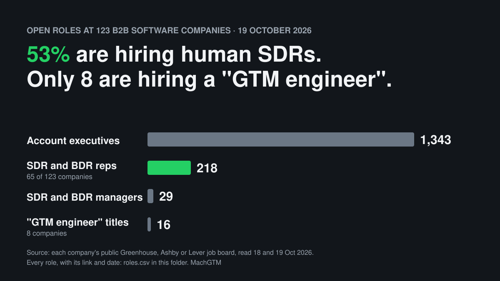
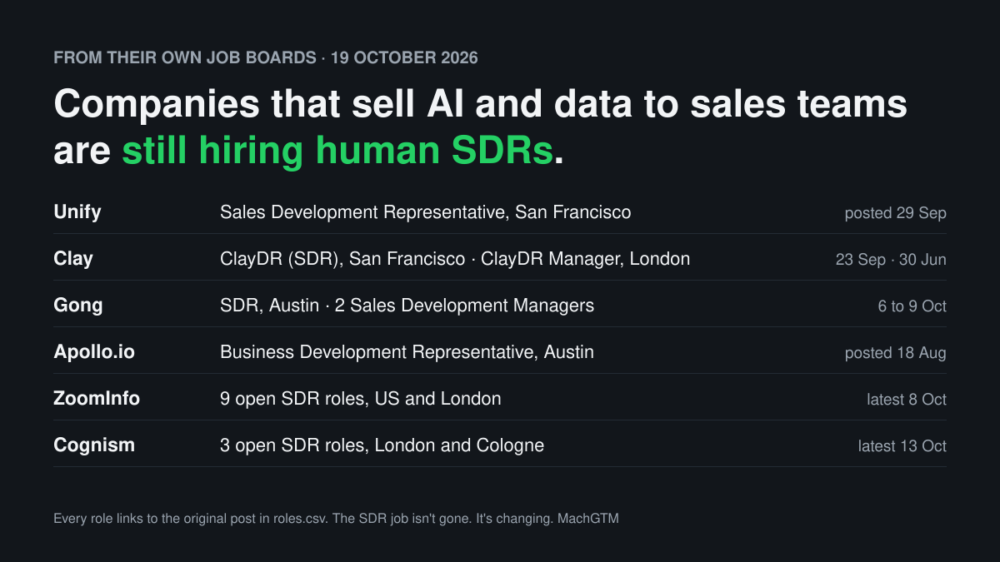

# Who's hiring SDRs: October 2026

A snapshot of open sales development roles at 123 B2B software companies, read from their own public job boards on 18 and 19 October 2026. Every number below comes from a file in this folder, and every role in it links to the original post.

## What we found

- **65 of 123 companies (53%) have at least one open SDR or BDR role.** 54 of them posted one in the last 90 days.
- **218 open SDR and BDR roles**, plus 29 for SDR and BDR managers. 133 of the 218 were posted in the last 90 days.
- **There are 6 account executive roles for every SDR role**: 1,343 against 218.
- **Only 16 roles have "GTM engineer" in the title, at 8 companies.** It's the most talked-about new sales role of the year. In this sample, SDR openings outnumber it 14 to 1.
- **Companies that sell AI and data to sales teams are hiring human SDRs too.** Unify, which describes itself as "the first AI-native outbound platform where agents and sellers work side by side", posted a Sales Development Representative role in San Francisco on 29 September. Clay, Gong, Apollo.io, ZoomInfo and Cognism all have open SDR roles.
- **26 of the open SDR posts are more than a year old**, and one dates from 2022. An open job post isn't always a fresh signal. Check the date before you call it one.

## Where the SDR roles are

| Region | Open SDR and BDR roles |
|---|---|
| US and Canada | 102 |
| Europe and Middle East | 66 |
| Asia-Pacific (not India) | 27 |
| Latin America | 5 |
| India | 4 |
| Not stated ("Hybrid", "Remote") | 14 |

## The files

| File | What's in it |
|---|---|
| [`companies.csv`](companies.csv) | One row per company: job board, open roles, SDR and BDR reps, SDR and BDR managers, account executives, GTM engineers, and the API link the numbers came from |
| [`roles.csv`](roles.csv) | Every SDR, BDR, SDR manager and GTM engineer role counted, with title, location, date posted and link |

## How it was done

1. **The sample.** 123 B2B software companies that publish jobs on Greenhouse, Ashby or Lever, chosen by us: well-known software companies plus sales and marketing tool makers. It is not a random sample or a census, and it leans towards larger, US-based companies. We tried 229 board names. 123 had open jobs, and those are the 123 here.
2. **The reading.** Each board's public API, read on 18 and 19 October 2026. No logins and no scraping.
3. **The counting.** By job title only:
   - **SDR or BDR rep**: "Sales Development Representative", "Business Development Representative", "Account Development Representative", SDR, BDR, ADR or MDR, not a manager or leader.
   - **SDR or BDR manager**: the same words with manager, director, head or lead.
   - **Account executive**: "Account Executive" in the title.
   - **GTM engineer**: "GTM engineer" or "go-to-market engineer" in the title.
4. **Freshness.** "Posted" is the first-published date the job board reports (Greenhouse `first_published`, or `updated_at` where that is missing; Ashby `publishedAt`; Lever `createdAt`). "Last 90 days" means on or after 21 July 2026.

## What this can't tell you

- Titles vary. A company that calls its AEs "Sales Executives" shows zero AEs here. Notion, for example, shows 10 BDR roles and no "Account Executive" titles.
- Companies are listed by their job-board name. A few short names (such as `otter` or `aligned`) may belong to a different company than the one you'd guess; the link in each row shows whose board it is.
- One post can cover several hires, and some posts stay open all year.
- This is one snapshot. It shows who is hiring now, not whether hiring is going up or down. We'll publish the same count each month so the trend builds up.

## Reuse

Data: CC BY 4.0. Please credit "MachGTM SDR hiring snapshot, October 2026" and link to this page.

Made with the job-board checks from [Lead Finder](https://github.com/MachGTM/lead-finder), a free Claude plugin. Published by [MachGTM](https://machgtm.com) under the [Receipts Standard](../../STANDARD.md): every claim above has a source in this folder.
